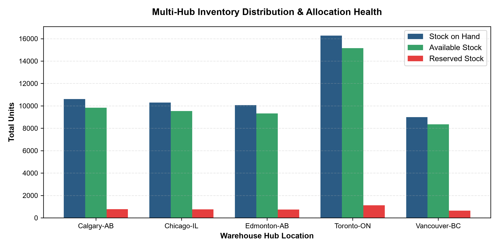
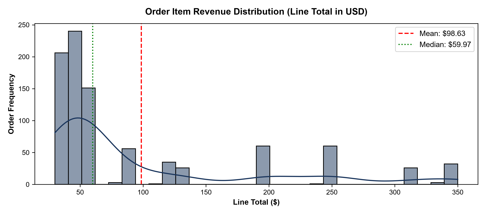
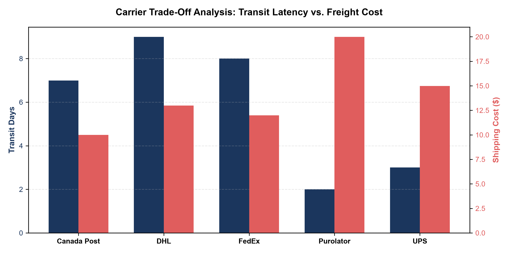

# Logistics Data Analytics Project

**Yuva Internship Programme | Data Analytics Portfolio**

## 📌 Project Overview

This project focuses on analyzing logistics and supply chain operations using data analytics techniques. It covers data cleaning, exploratory data analysis, inventory analysis, order analysis, shipping performance and strategic planning.

The objective is to transform raw operational data into meaningful insights that can support better business decisions, improve operational efficiency and identify opportunities for optimization.

## 🎯 Project Objectives

- Clean and prepare raw logistics datasets.
- Identify missing values, duplicates and data inconsistencies.
- Perform exploratory data analysis (EDA).
- Analyze orders, inventory, products and shipping operations.
- Understand warehouse inventory status and order value distribution.
- Explore carrier transit performance and shipping costs.
- Generate actionable business insights.

## 🛠️ Tools & Technologies

- **Python** – Data cleaning and analysis
- **Pandas** – Data manipulation and preprocessing
- **Jupyter Notebook** – Interactive analysis
- **Matplotlib / Data Visualization** – Visual representation of findings
- **CSV** – Dataset storage and exchange
- **Git & GitHub** – Version control and project documentation

## 📂 Project Structure

```text
Logistics-Data-Analytics-Project/
│
├─Logistics-Data-Analytics-Project/
│
├── Phase1-Strategic Planning and Data Exploration in Logistics/
│   ├── inventory_cleaned.csv
│   ├── order items_cleaned.csv
│   ├── Orders (2)_cleaned.csv
│   ├── products (1)_cleaned.csv
│   ├── shipping table_cleaned.csv
│   └── Week_1_Strategic_Planning_Report.docx
│
├── Raw_data/
│   ├── inventory.csv
│   ├── order items.csv
│   ├── Orders (2).csv
│   ├── products (1).csv
│   └── shipping table.csv
│
├── Cleaned_Data/
│   ├── Cleaning_Report.csv
│   ├── Python scripts
│   ├── Visualizations
│   └── Analysis reports
│
├── Logistics_Data_Cleaning.ipynb
├── README.md
└── .gitignore
```

## 📊 Phase 1 – Data Cleaning & Strategic Planning

The first phase focuses on preparing logistics datasets for analysis.

### Activities Completed

- Imported and explored raw CSV datasets.
- Cleaned inventory, orders, order items, products and shipping data.
- Standardized and prepared datasets for further analysis.
- Exported cleaned datasets.
- Generated a data cleaning report.
- Conducted initial data exploration.
- Created visualizations for:
  - Warehouse inventory status
  - Order value distribution
  - Carrier transit cost analysis
- Prepared a Week 1 Strategic Planning Report.

### Project Visualizations

**Warehouse Inventory Status**



**Order Value Distribution**



**Carrier Transit Cost Analysis**



## 📁 Project Deliverables

- Raw datasets
- Cleaned datasets
- Python Jupyter Notebook
- Python analysis scripts
- Data cleaning report
- Strategic planning report
- Data visualization charts

## 🚀 Future Project Phases

This repository will be updated as the internship progresses.

Future phases will include additional analysis, business insights, reporting and visualization as applicable.

## 👩‍💻 Author

**Jishma P J**

Data Analytics | Python | Pandas | Excel | SQL | Power BI

GitHub: [Jishmapj](https://github.com/Jishmapj)

---

*This repository documents my learning journey and practical work throughout the Yuva Internship Programme.*